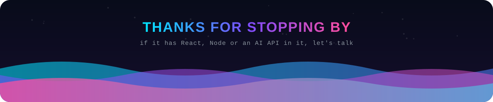

 

<h2 align="center"> A bit about me</h2>

 

<h2 align="center"> What I'm up to</h2>

<table align="center">
  <tr>
    <td width="48" align="center"></td>
    <td><b>Building</b></td>
    <td>BuilderAI, an AI website builder. You describe a site, it gives you a live one.</td>
  </tr>
  <tr>
    <td align="center"></td>
    <td><b>Learning</b></td>
    <td>AWS, Docker, Kubernetes, Terraform, System Design and DSA</td>
  </tr>
  <tr>
    <td align="center"></td>
    <td><b>Up for collabs</b></td>
    <td>Full-stack, MERN and AI-powered projects</td>
  </tr>
  <tr>
    <td align="center"></td>
    <td><b>Could use a hand with</b></td>
    <td>System design, cloud architecture, scalable backends</td>
  </tr>
  <tr>
    <td align="center"></td>
    <td><b>Ask me about</b></td>
    <td>React, Next.js, Node.js, Express, REST APIs, MongoDB, AWS</td>
  </tr>
  <tr>
    <td align="center"></td>
    <td><b>Reach me</b></td>
    <td><a href="mailto:rajkaransharma254@gmail.com">rajkaransharma254@gmail.com</a></td>
  </tr>
</table>

<h2 align="center"> Tech I work with</h2>

 

**Languages** 

**Frontend** 

**Backend and data** 

**Cloud and DevOps** 

<h2 align="center"> Things I've built</h2>

<table align="center">
  <tr>
    <td width="50%" valign="top">
      <h3><a href="https://imagify-frontend-6t9r.onrender.com/">Imagify</a></h3>
      Text-to-image SaaS. Type a prompt, get an image, pay for credits through Razorpay.  
      <code>React</code> · <code>Tailwind</code> · <code>Node</code> · <code>Express</code> · <code>MongoDB</code>
    </td>
    <td width="50%" valign="top">
      <h3><a href="https://ai-resume-analyser453.netlify.app/">RESUMIND</a></h3>
      Upload a resume and get an ATS score with specific things to fix. Runs without a custom backend.  
      <code>React</code> · <code>TypeScript</code> · <code>Tailwind</code> · <code>Puter.js</code> · <code>PDF.js</code>
    </td>
  </tr>
  <tr>
    <td valign="top">
      <h3><a href="https://rajkaran-dev.onrender.com/">BuilderAI</a> in progress</h3>
      Describe a website in plain words and get a live, editable site back.  
      <code>React</code> · <code>Node</code> · <code>Express</code> · <code>AI API</code>
    </td>
    <td valign="top">
      <h3><a href="https://aaroh-j1p2.onrender.com/">Aaroh: Together We Ascend</a></h3>
      A community site around environmental health and sharing educational resources.  
      <code>React</code> · <code>Vite</code> · <code>Tailwind</code> · <code>Framer Motion</code>
    </td>
  </tr>
  <tr>
    <td valign="top">
      <h3><a href="https://www.orrdr.com/">Orrdr</a></h3>
      E-commerce front end with a storefront and an admin dashboard (orders, products, vendors, charts).  
      <code>Next.js</code> · <code>TypeScript</code> · <code>React</code> · <code>Bootstrap</code>
    </td>
    <td valign="top">
      <h3><a href="https://github.com/Notyetknown/lovable-clone-website-generator">Lovable.dev UI clone</a></h3>
      A React + Vite recreation of the Lovable.dev landing page.  
      <code>React</code> · <code>Vite</code> · <code>CSS</code>
    </td>
  </tr>
</table>

<h2 align="center"> Experience and highlights</h2>

<table align="center">
  <tr>
    <td valign="top" width="50%">
      <h3>Software Engineer Intern</h3>
      <b>Agastyaan Technology</b>, Mohali · Apr to Sep 2026
      <ul>
        <li>Built React UIs and reusable components with Tailwind</li>
        <li>Wrote REST APIs with auth, validation and proper error handling</li>
        <li>Supported cloud, container and CI/CD work with AWS, Docker and Linux</li>
        <li>Got page rendering time down to 2 seconds on a company project</li>
      </ul>
    </td>
    <td valign="top" width="50%">
      <h3>Zomathon: The Data Hackathon</h3>
      Organised by Coding Ninjas with Eternal · 2026
      <ul>
        <li>Top 15 out of 200 teams in the transport track</li>
      </ul>
    </td>
  </tr>
</table>

<h2 align="center"> GitHub stats</h2>

  
  

  

  

  

<h2 align="center"> Snake eats my commits</h2>

  <picture>
    <source media="(prefers-color-scheme: dark)" srcset="https://raw.githubusercontent.com/Notyetknown/Notyetknown/output/github-snake-dark.svg"/>
    <source media="(prefers-color-scheme: light)" srcset="https://raw.githubusercontent.com/Notyetknown/Notyetknown/output/github-snake.svg"/>
    
  </picture>

<h2 align="center"> LeetCode</h2>

  

 

